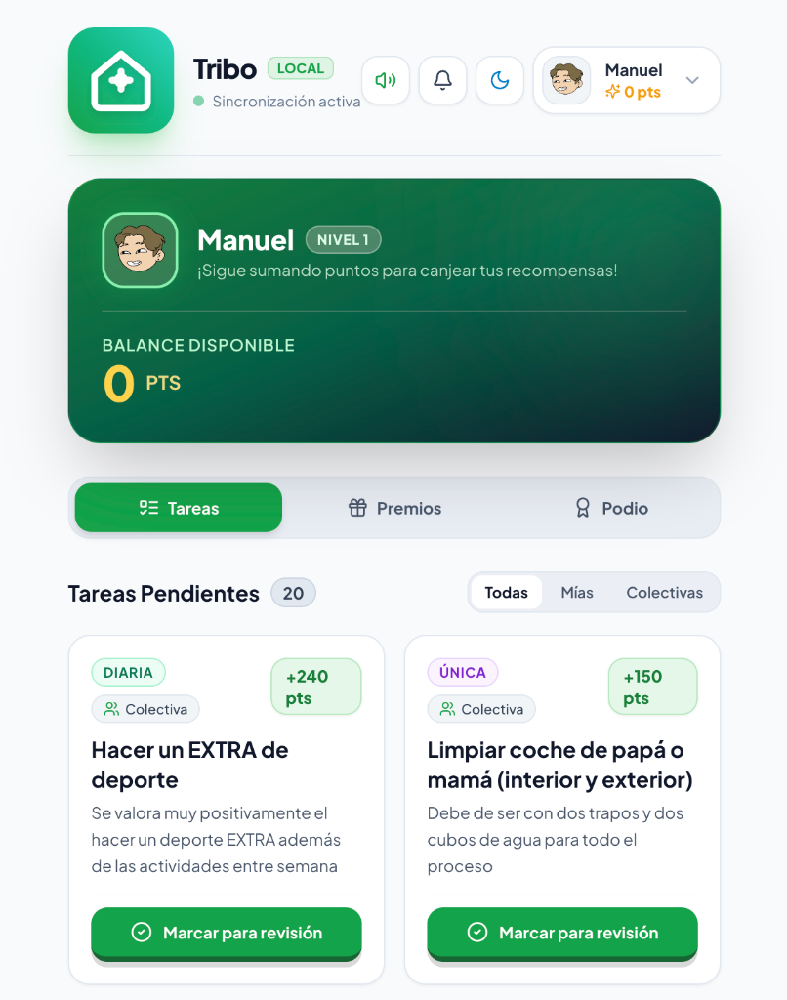
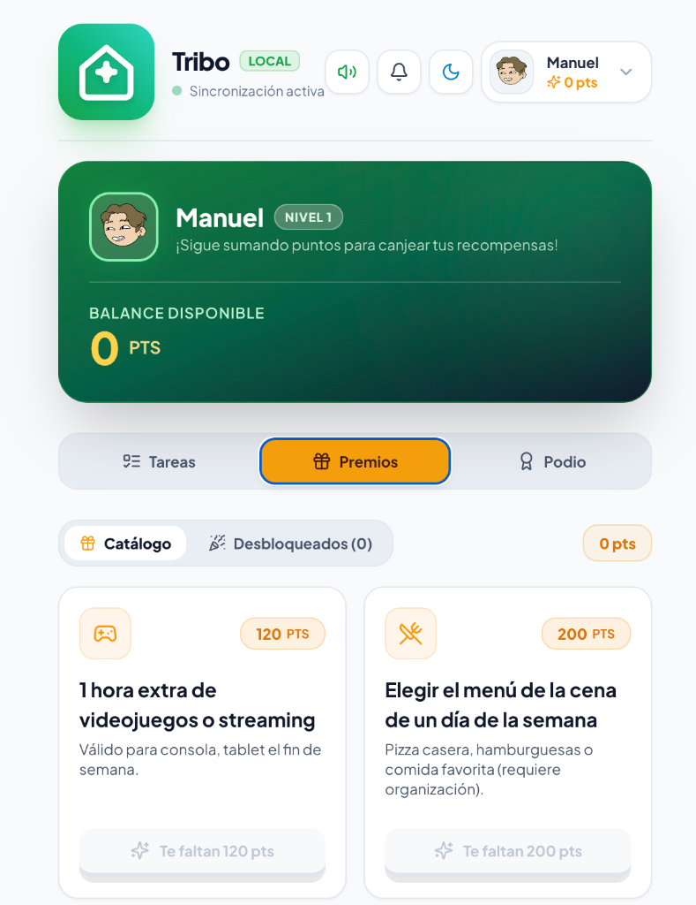
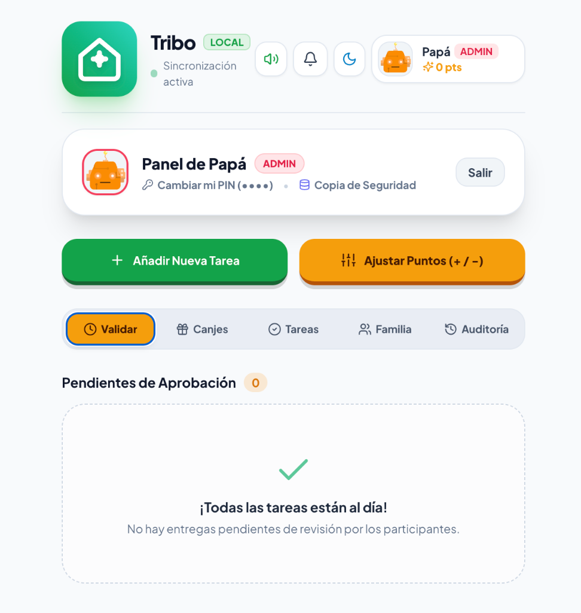
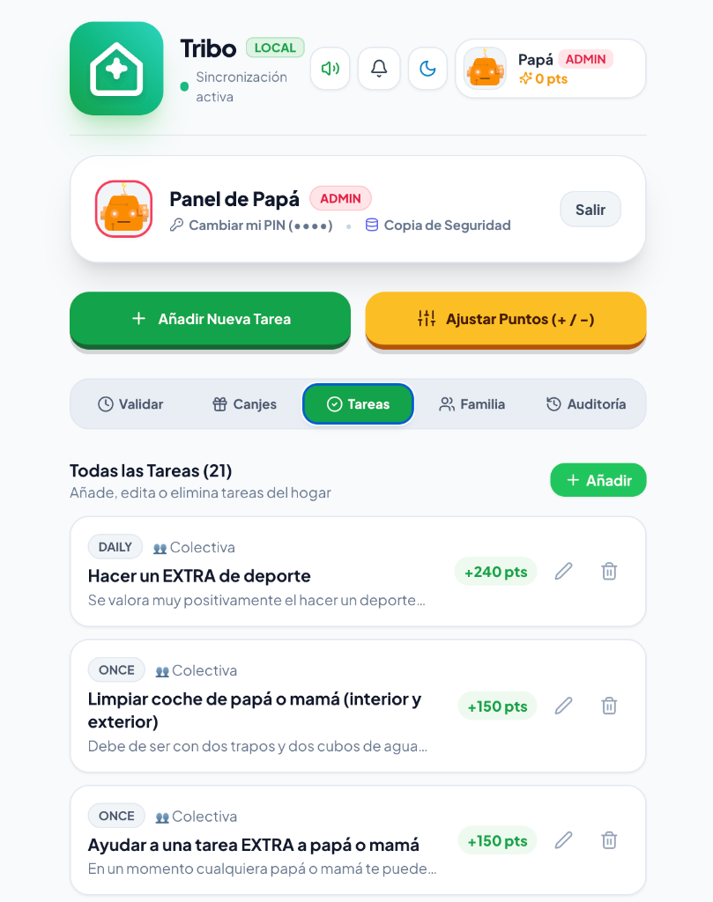

<div align="center">
  

  # 🎸 Paganini
  ### Gestión Familiar de Tareas, Hábitos y Recompensas

  *Plataforma gamificada, mobile-first y moderna para coordinar tareas del hogar, motivar buenos hábitos familiares y gestionar recompensas con sincronización en tiempo real.*

  <br />

  [🚀 Abrir Aplicación](https://paganini-five.vercel.app) • [📸 Vistas](#-vistas-de-la-aplicación) • [🌟 Características](#-características-principales) • [🛠️ Instalación](#-puesta-en-marcha-local)

</div>

---

## 📸 Vistas de la Aplicación

| 📋 Tareas del Participante | 🎁 Catálogo de Recompensas |
|:---:|:---:|
|  |  |
| *Visualización de tareas diarias, puntos acumulados y entregas* | *Canje de premios por puntos acumulados y recompensas desbloqueadas* |

| ✅ Panel Admin (Validaciones) | 🛠️ Panel Admin (Gestión de Tareas) |
|:---:|:---:|
|  |  |
| *Supervisión con PIN individual, backups y aprobación rápida* | *Catálogo general de tareas: añadir, editar o penalizaciones* |

---

## 🌟 Características Principales

### 1. Experiencia Visual y Gamificación
- **Diseño Mobile-First y Moderno:** Interfaz optimizada para smartphones, tablets y pantallas de escritorio.
- **Modo Claro y Oscuro:** Selector de tema persistente (Dark / Light mode) con paletas HSL cuidadas y tipografía de alta legibilidad (*Plus Jakarta Sans*).
- **Identidad de Marca:** Logotipo dinámico (*PaganiniLogo*) con el icónico avatar 3D del papá rockero (camiseta de Héroes del Silencio, barba y billetes de euro volando).
- **Motor de Sonido Háptico (Web Audio API):**
  - Sonidos de pulsación mecánica de teclado al hacer clic en botones y teclado de PIN.
  - Fanfarria de victoria y lluvia de confeti (`canvas-confetti`) al canjear recompensas.
  - Chime armonioso de éxito al aprobar tareas o restaurar copias de seguridad.
  - Tono de advertencia en penalizaciones.
  - Botón de silenciar/activar efectos sonoros en la cabecera.

### 2. Roles, Identidades y Seguridad
- **Perfiles de Padres Independientes (ADMIN):** Perfiles separados para **Papá** y **Mamá**, cada uno con su propio PIN de 4 dígitos personalizable individualmente desde la cabecera.
- **Fotos de Perfil Personalizadas:** Posibilidad de subir fotos reales directamente desde el dispositivo (móvil o PC mediante FileReader) o elegir avatares ilustrados de DiceBear.
- **Activar o Desactivar Usuarios:** Opción para poner en pausa perfiles de forma temporal (el usuario queda congelado sin perder sus puntos ni historial, excluyéndose del podio activo semanal hasta su reactivación).
- **Teclado Numérico con PIN:** Acceso al Modo Administrador protegido mediante teclado táctil interactivo.

### 3. Gestión Integral de Tareas (CRUD)
- **Creación y Edición Completa:** Formulario modal para añadir nuevas tareas o editar existentes (con campos precargados).
- **Puntuación Flexible:** Soporta puntos positivos (bonificaciones) y puntos negativos (penalizaciones automáticas por conductas no deseadas).
- **Asignación:** Tareas colectivas (cualquier miembro puede completarlas) o asignadas individualmente a un miembro específico.
- **Frecuencia:** Tareas diarias, semanales o puntuales.
- **Flujo de Validación:** Los hijos marcan tareas como *"Pendiente de revisión"* y los padres las aprueban o rechazan con un toque en la pestaña **Validar**.

### 4. Catálogo y Gestión de Recompensas
- **Catálogo Interactivo para Participantes:** Los chicos canjean sus puntos acumulados por premios reales configurados por la familia (videojuegos, menús especiales, cine, salidas, etc.).
- **Sección de Premios Desbloqueados:** Historial visual donde los participantes consultan la fecha, hora, coste y estado de cada recompensa canjeada.
- **Gestión Completa de Premios en Modo Admin:**
  - **Solicitudes de Canje:** Vista para marcar los premios disfrutados como *"Entregados"*.
  - **Catálogo de Premios:** Panel para crear nuevos premios, definir su coste en puntos, añadir descripciones y elegir entre 12 iconos temáticos (juegos, cine, comida, dinero, postres, etc.), además de editarlos o eliminarlos.

### 5. Notificaciones en Tiempo Real por Usuario
- **Campanita con Contador Dinámico:** Notificaciones sincronizadas sobre revisiones de tareas y canjes de premios.
- **Punto Rojo Individual:** Si un usuario abre sus notificaciones, el indicador desaparece de inmediato en su perfil pero se mantiene visible para los demás miembros de la familia que aún no las han leído.
- **Bandeja Limpia:** Posibilidad de eliminar notificaciones individuales o vaciar la bandeja completa.

### 6. Copias de Seguridad y Restauración (Backup & Restore)
- **Ubicación Discreta:** Acceso directo desde la cabecera de administración junto al PIN, manteniendo la interfaz 100% limpia y sin sobrecargar la pantalla.
- **Exportación JSON:** Descarga inmediata de un archivo `.json` fechado con todas las tareas, premios y perfiles.
- **Restauración Segura:** Permite cargar cualquier copia previa para recuperar tareas y recompensas sin duplicados.
- **Copia de Respaldo Incluida:** Archivo estático de respaldo disponible en `backups/catalogo_tareas_y_premios.json`.

---

## 🛠️ Stack Tecnológico

- **Framework Web:** [Next.js 15](https://nextjs.org/) (App Router) + [TypeScript](https://www.typescriptlang.org/)
- **Estilos:** [Tailwind CSS](https://tailwindcss.com/) con soporte de modo oscuro y clases de diseño gamificado
- **Base de Datos:** SQLite local o PostgreSQL en Supabase gestionado con **Prisma ORM**
- **Estado y Sincronización:** **Server Actions** para mutaciones transaccionales y **SWR** (revalidación periódica y en foco) para actualización instantánea en red local
- **Audio:** Sintetizador Web Audio API nativo (sin dependencias externas de archivos de audio)
- **Iconografía:** [Lucide React](https://lucide.dev/) y animaciones de confeti con `canvas-confetti`

---

## 📂 Estructura del Proyecto

```text
Paganini/
├── backups/
│   └── catalogo_tareas_y_premios.json  # Copia de seguridad estática de tareas y premios
├── prisma/
│   ├── dev.db                          # Base de datos SQLite local
│   ├── schema.prisma                   # Esquema de base de datos relacional
│   └── seed.js                         # Semilla para inicialización de datos
├── public/
│   ├── icon-192.png                    # Icono PWA (192x192)
│   ├── icon-512.png                    # Icono PWA (512x512)
│   ├── apple-touch-icon.png            # Icono para iOS Safari
│   ├── favicon.ico                     # Favicon del navegador
│   ├── paganini-logo.png               # Logo e icono de cabecera de alta resolución
│   └── manifest.json                   # Manifiesto PWA para instalación móvil
├── src/
│   ├── app/
│   │   ├── actions.ts                  # Server Actions (CRUD tareas, premios, usuarios, PIN, notificaciones y backups)
│   │   ├── api/
│   │   │   └── data/
│   │   │       └── route.ts            # Endpoint de sincronización en tiempo real vía SWR
│   │   ├── globals.css                 # Variables de diseño, botones táctiles gamificados y temas
│   │   ├── layout.tsx                  # Layout raíz, metadatos SEO y fuentes tipográficas
│   │   └── page.tsx                    # Vista principal, switch de usuarios y sincronizador
│   ├── components/
│   │   ├── AdminView.tsx               # Panel de control de padres (Validar, Canjes, Tareas, Familia, Auditoría)
│   │   ├── BackupModal.tsx             # Modal para exportar y restaurar copias de seguridad JSON
│   │   ├── ChangePinModal.tsx          # Modal para cambiar el PIN individual de Papá o Mamá
│   │   ├── EditUserModal.tsx           # Ficha de miembro (foto de dispositivo, rol, PIN, saldo, activar/pausar)
│   │   ├── ManualPointsModal.tsx       # Ajuste manual rápido de puntos (+/-) con motivo
│   │   ├── NotificationBell.tsx        # Campanita con estados de lectura individual por usuario
│   │   ├── PaganiniLogo.tsx            # Componente de marca e icono 3D de la aplicación
│   │   ├── ParticipantView.tsx         # Dashboard del participante (tareas, catálogo, desbloqueados y ranking)
│   │   ├── PinModal.tsx                # Teclado numérico táctil para autenticación de padres
│   │   ├── PodiumRanking.tsx           # Podio semanal gamificado (oro, plata y bronce)
│   │   ├── RewardCard.tsx              # Tarjeta de premio con botón de canje, sonidos y confeti
│   │   ├── RewardModal.tsx             # Modal para crear y editar premios del catálogo
│   │   ├── TaskCard.tsx                # Tarjeta de tarea con botón de marcar para revisión
│   │   ├── TaskModal.tsx               # Modal de creación y edición completa de tareas
│   │   ├── ThemeToggle.tsx             # Interruptor de Modo Claro / Modo Oscuro
│   │   └── UserSwitcher.tsx            # Selector desplegable de perfiles familiares
│   └── lib/
│       ├── prisma.ts                   # Cliente singleton de Prisma ORM
│       ├── sounds.ts                   # Motor de sonidos hápticos con Web Audio API
│       ├── types.ts                    # Definiciones TypeScript de modelos y DTOs
│       └── utils.ts                    # Formateo de fechas y utilidades auxiliares
├── package.json
├── tailwind.config.ts
└── tsconfig.json
```

---

## 🚀 Puesta en Marcha Local

### 1. Instalar dependencias
```bash
npm install
```

### 2. Sincronizar la base de datos local
```bash
npx prisma db push
```

### 3. Iniciar el servidor local
```bash
npm run dev
```

Abre en tu navegador: [http://localhost:3000](http://localhost:3000)

> 📱 **Acceso desde móviles y tablets en la misma red WiFi:**
> Ejecutando `npx next dev -H 0.0.0.0`, cualquier dispositivo de la familia puede conectarse a través de la IP local de tu ordenador (por ejemplo: `http://192.168.1.72:3000`).

---

## 🌐 Despliegue en la Nube (Vercel + Supabase)

Si deseas subir la aplicación a internet para utilizarla fuera de casa con datos móviles 4G/5G:

1. **Base de Datos en Supabase:**
   - Crea un proyecto en [Supabase](https://supabase.com/).
   - En `prisma/schema.prisma`, cambia `provider = "sqlite"` por `provider = "postgresql"`.
   - Copia la URL de conexión en tus variables de entorno (`DATABASE_URL`).
   - Ejecuta `npx prisma db push` para crear las tablas en la nube.
2. **Alojamiento en Vercel:**
   - Conecta tu repositorio de GitHub a [Vercel](https://vercel.com/).
   - Configura la variable de entorno `DATABASE_URL` de Supabase.
   - Vercel desplegará automáticamente la aplicación con dominio seguro HTTPS.
3. **Cargar tus Tareas y Premios:**
   - Puedes usar la opción **«Restaurar Copia»** desde la propia app subiendo el archivo `backups/catalogo_tareas_y_premios.json`, cargando todas tus tareas y premios en 2 segundos.

## 🏆 Historial de Versiones

### 🎸 Release v1.1.0 (Paganini Edition & Rebranding)
- 🎨 **Nuevo Nombre e Identidad**: Cambio oficial de nombre a **Paganini** en toda la aplicación, metadatos PWA y documentación.
- 🖼️ **Iconografía 3D Full-Bleed**: Nuevo icono de marca exclusivo en alta definición con el papá rockero (camiseta de Héroes del Silencio, barba, gafas y billetes de euro volando), optimizado de borde a borde para pantallas retina, accesos directos de móviles (PWA) y favicon de navegador.
- 🌐 **Despliegue y Dominios**: Conexión y despliegue sincronizado en Vercel (`paganini-five.vercel.app`) y repositorio GitHub renombrado.
- 📋 **Copias de Seguridad Actualizadas**: Sistema de backup y restauración con prefijo oficial `paganini-backup-*.json`.

### 📦 Release v1.0.0
Esta versión inicial consolidó las funcionalidades clave:
- 📱 **Soporte PWA Completo**: Compatible con iOS (iPhone/iPad), Android y navegadores de escritorio para añadir como aplicación independiente a la pantalla de inicio.
- ☁️ **Sincronización Dual**: Funciona tanto en Red Local offline-first como en la Nube con Supabase y Vercel en tiempo real.
- 🥇 **Podio Gamificado**: Visualización animada de clasificación con trofeos (Oro, Plata, Bronce) y actualización en vivo de puntos.
- 🔄 **Lógica de Tareas Diarias y Únicas**: Las tareas diarias se reactivan cada medianoche (00:00).
- 🔔 **Notificaciones en Vivo**: Campanita en tiempo real con panel adaptativo.
- 🔐 **Control Parental Seguro**: Modo administrador protegido por PIN con historial de auditoría y copias de seguridad descargables en JSON.
